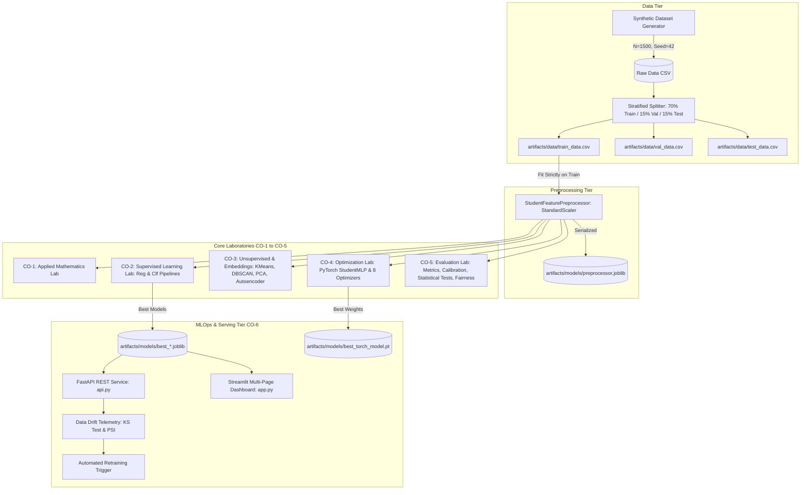

# PROPOSED METHODOLOGY & SYSTEM ARCHITECTURE

## 1. System Architecture Overview
The architecture is structured according to clean separation of concerns, ensuring zero data leakage, modular maintainability, and reproducibility.

---

## 2. Methodology by Course Outcome

### 2.1 CO-1: Applied Mathematics Foundations
- **Linear Algebra:** Student vectors are extracted directly from the design matrix $\mathbf{X} \in \mathbb{R}^{N \times 5}$. Vector operations compute inner products, norms, and cosine similarities. The sample covariance matrix $\mathbf{\Sigma} = \frac{1}{N-1} (\mathbf{X} - \mathbf{\mu})^T (\mathbf{X} - \mathbf{\mu})$ is computed without bias. Eigendecomposition is solved using SciPy/NumPy `linalg.eigh` ensuring orthogonal eigenvectors and ordered eigenvalues. SVD decomposes $\mathbf{X} = \mathbf{U} \mathbf{\Sigma} \mathbf{V}^T$ to provide low-rank matrix approximations.
- **Probability & Statistics:** Demonstrates sample variance with Bessel's correction factor $\frac{n}{n-1}$. Expectation and variance identities are numerically verified across student metrics. Bayes' Theorem computes posterior probabilities $P(\text{Excellent} | \text{High Study})$ and matches empirical conditionals. Confidence intervals are constructed using Student's t-distribution. Maximum Likelihood Estimation (MLE) is contrasted with Bayesian Maximum A Posteriori (MAP) estimation to show parameter shrinkage.
- **Calculus & Optimization:** Exact analytical gradients and Hessians are computed for regularized Mean Squared Error surfaces. Positive-definiteness of the Hessian verifies strict convexity. Convexity is also confirmed numerically via Jensen's secant chord inequality. An interactive gradient descent step simulator reveals convergence, under-relaxation, and divergence. Constrained optimization is solved using Lagrange Multipliers and verified against Karush-Kuhn-Tucker (KKT) stationarity, primal feasibility, dual feasibility, and complementary slackness.

### 2.2 CO-2: Supervised Learning
- **Zero Leakage Pipeline:** Preprocessing scalers are fitted exclusively on the 70% training split and applied downstream to validation and test sets using `sklearn.pipeline.Pipeline`.
- **Regression:** Compares Linear Regression, Polynomial Regression (degree 2 with interaction terms), Ridge Regression ($L_2$ penalty), Lasso Regression ($L_1$ penalty), and ElasticNet (convex combination of $L_1$ and $L_2$).
- **Classification:** Evaluates Logistic Regression, Gaussian Naive Bayes, K-Nearest Neighbors ($k=7$), Decision Tree (pruned max_depth=5), Random Forest (100 estimators), Support Vector Machines (Linear, RBF, and Polynomial kernels), and XGBoost.
- **Bias-Variance Decomposition:** Uses non-parametric bootstrap resampling (25 draws) to empirically decompose test MSE into $\text{Bias}^2$, $\text{Variance}$, and noise across polynomial degrees 1 through 5.
- **Hyperparameter Optimization:** Demonstrates both `GridSearchCV` and `RandomizedSearchCV` with 5-fold cross-validation.

### 2.3 CO-3: Unsupervised Learning & Embeddings
- **Clustering:** K-Means with inertia elbow curve and silhouette score; DBSCAN for density-connected clusters and noise detection; Agglomerative Hierarchical Clustering with Ward linkage; and Gaussian Mixture Models (GMM) with Bayesian Information Criterion (BIC).
- **Dimensionality Reduction:** PCA with scree plots and eigenvector loading matrices; t-SNE with perplexity tuning; and UMAP manifold projection.
- **Anomaly Detection:** Isolation Forest and One-Class SVM identify multivariate outliers, complemented by automated pedagogical explanation generation using feature z-scores.
- **Representation Learning:** A shallow PyTorch neural autoencoder compresses the 5D feature space into a 2D latent bottleneck $z$. A separate NLP demonstration demonstrates TF-IDF term vectors and cosine similarity on educational course reviews.

### 2.4 CO-4: Optimization and Deep Learning
- **PyTorch MLP Architecture:** A lightweight multi-layer perceptron (5 inputs $\to$ 16 hidden $\to$ 8 hidden $\to$ 1 output) built for CPU execution.
- **Multi-Optimizer Benchmark:** Compares eight first-order optimization algorithms under identical seed and weight initializations: SGD, Momentum, Nesterov, Adagrad, RMSprop, Adam, AdamW, and the Google Lion optimizer.
- **Learning Rate Schedules:** Compares StepLR, CosineAnnealingLR, CosineAnnealingWarmRestarts, and OneCycleLR.
- **Regularization & Initialization:** Evaluates $L_2$ weight decay, Dropout ($p=0.25$), Batch Normalization, and Early Stopping with patience recovery. Contrasts Xavier (Glorot) uniform initialization with He (Kaiming) normal initialization.

### 2.5 CO-5: Model Evaluation and Selection
- **Metric Telemetry:** Measures continuous (MAE, RMSE, $R^2$, MAPE) and discrete metrics (Accuracy, Precision, Recall, Macro F1, ROC-AUC, PR-AUC, MCC).
- **Probability Calibration:** Reliability diagrams, Expected Calibration Error (ECE), Platt Scaling (logistic sigmoid), and Isotonic Regression calibration.
- **Statistical Significance:** Paired Student's t-test on cross-validation folds, McNemar's paired chi-squared test with Edwards continuity correction, and empirical bootstrap 95% confidence intervals.
- **Validation Schemes:** Stratified K-Fold, Group-Aware K-Fold, and Time-Series expanding window cross-validation.
- **Algorithmic Fairness:** Demographic Parity ratio, Equal Opportunity difference, and Equalized Odds evaluated on synthetic campus subgroups.

### 2.6 CO-6: Production ML Engineering / MLOps
- **Microservice:** FastAPI REST API with Pydantic V2 input validation schemas for `/predict` and `/batch_predict`.
- **Statistical Drift Telemetry:** Two-sample Kolmogorov-Smirnov tests and Population Stability Index (PSI) calculate feature drift against reference baselines.
- **Retraining Automation:** Automated rule-based evaluation triggering retraining when $\ge 2$ features drift or rolling RMSE degrades by $>15\%$.
- **Governance:** Model Cards adhering to Mitchell et al. (2019) standards, SHA-256 artifact checksums, and GitHub Actions continuous integration.
